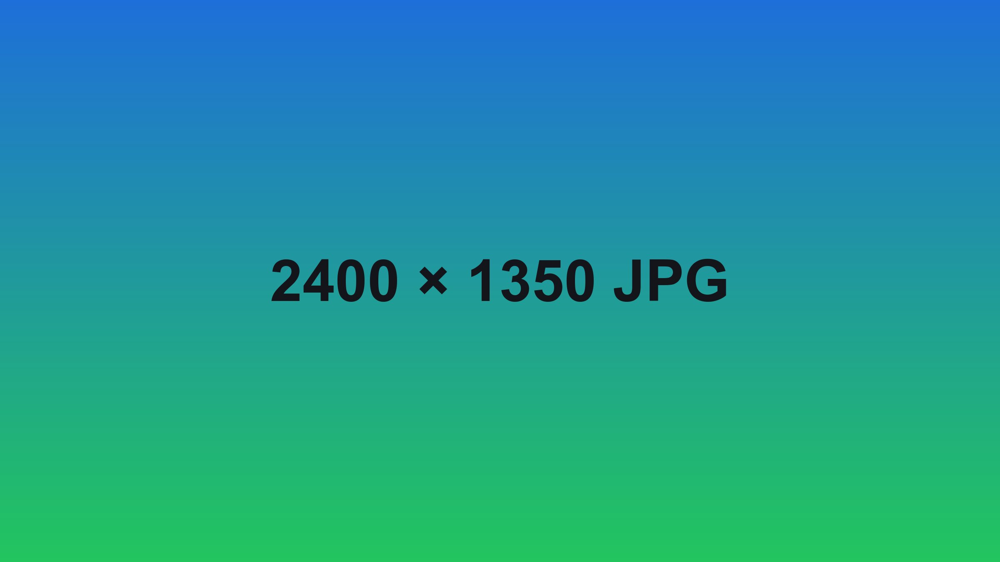
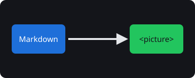

+++
title = "Images: what the render hook does"
date = 2026-11-14T10:00:00+01:00
description = "Every case handled by the theme's image render hook: page resources, global assets, remote URLs, SVG, GIF, captions and inline images."
tags = ["hugo", "images", "markdown"]
categories = ["dev"]
toc = true
+++

The theme ships an image render hook (`layouts/_markup/render-image.html`)
that turns plain Markdown images into responsive markup. Here is what it does
with each kind of source, so you can check how it looks.

## How the hook picks an image

1. It looks for the file next to the post, in the **page bundle**.
2. Failing that, it looks in the site's **`assets/`** folder.
3. Anything else (a remote URL, a file in `static/`) is output as a plain
   ``, unchanged.

JPG, PNG and WebP files are **processed**: they are resized to at most 1600px
wide and wrapped in a `<picture>` with AVIF and WebP sources, with `width` and
`height` set so the page doesn't jump while it loads. SVG and GIF are left as
they are.

## Block image with a caption

An image on its own line becomes a `<figure>`, and its title becomes the
`<figcaption>`.

```markdown

```


## Block image without a caption

No title means no `<figcaption>`. The image is smaller than 1600px, so it is
converted but not resized.

```markdown

```


## WebP source

A WebP file gets only an AVIF `<source>`: a WebP source would duplicate the
fallback ``.

```markdown

```


## Global asset

The file lives in `assets/images/`, not in the post folder. It is processed
like a page resource.

```markdown

```


## Inline image

An image inside a sentence stays inline. Its title becomes a `title`
attribute (a tooltip) instead of a caption: here is one
 in the middle of a
line.

```markdown
here is one  in the middle
```

## SVG

Vector images can't be resized or converted, so they are output as they are.

```markdown

```


## Animated GIF

GIFs are left alone too, so the animation survives.

```markdown

```


## Remote image

A full URL is never downloaded or processed. It becomes a plain `` with
lazy loading.

```markdown

```


## Alt text

The alt text is the text between the brackets, with any Markdown stripped (and
straight quotes turned into curly ones by Goldmark's typographer). Leave it empty only for purely decorative images.

```markdown

```


